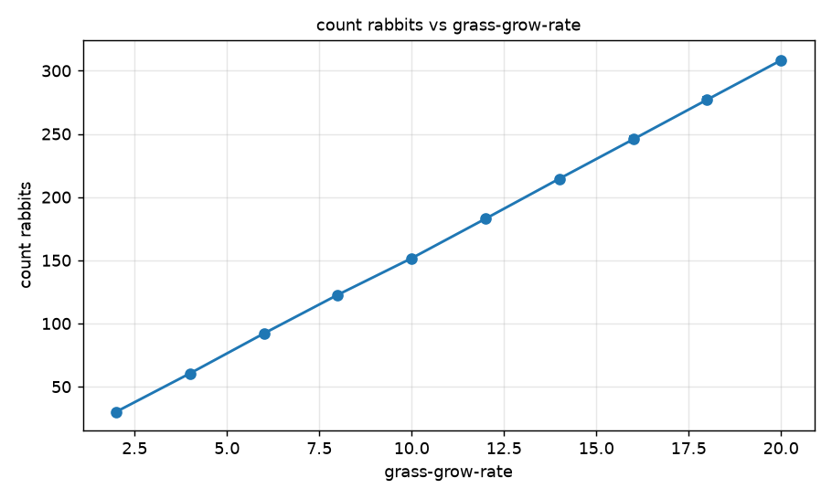
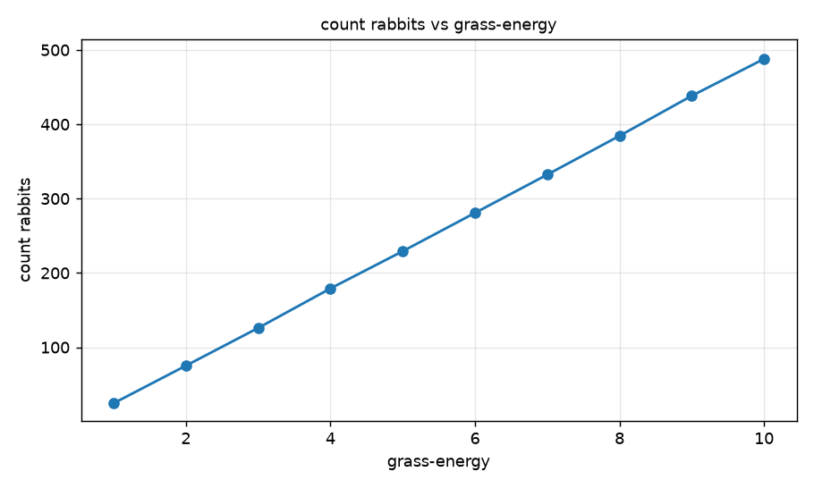
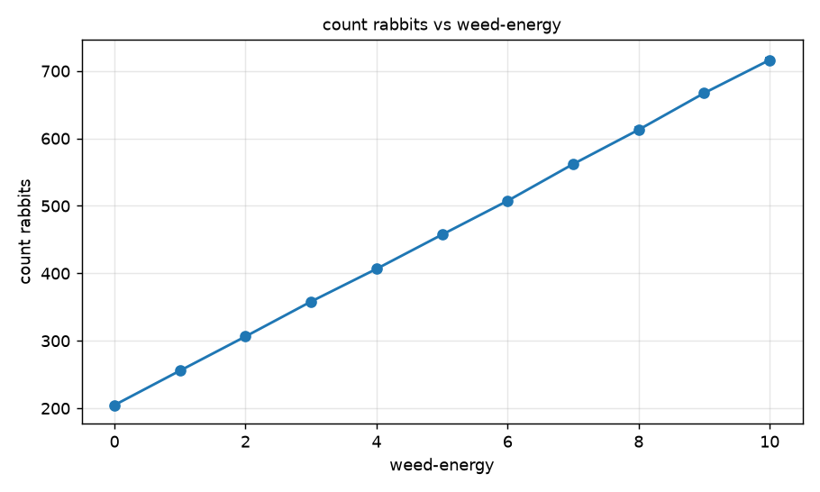
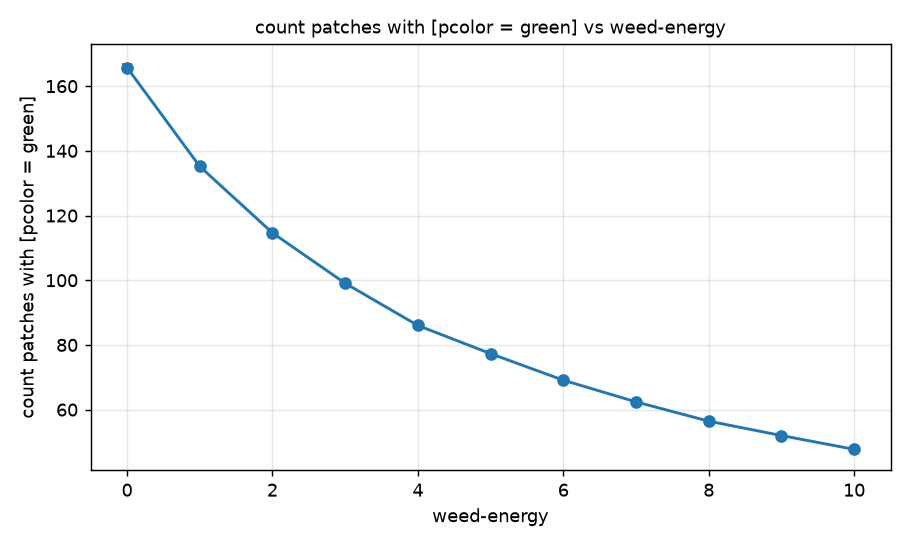
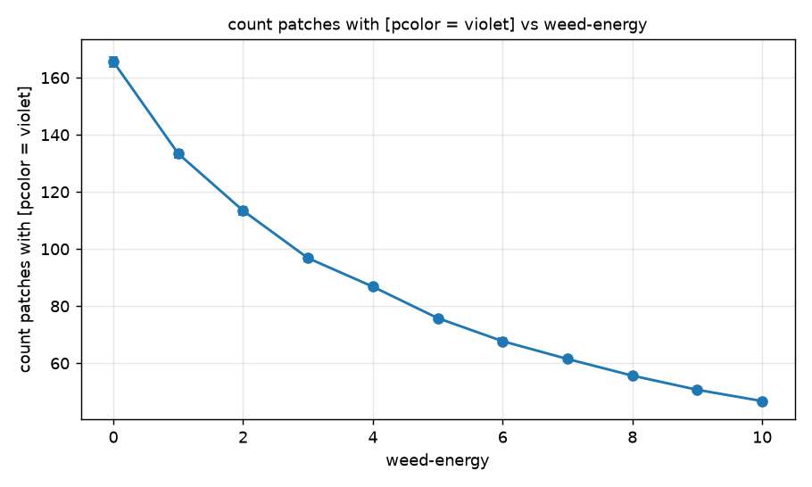
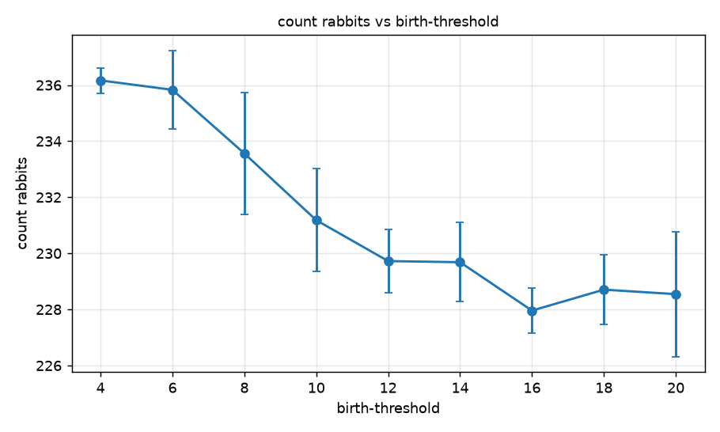

# Комп'ютерні системи імітаційного моделювання

## СПм-25-2, **Лебідь Іван Сергійович**

### Лабораторна робота №**1**. Опис імітаційних моделей та проведення обчислювальних експериментів

 

### Варіант 6, модель у середовищі NetLogo:
[Rabbits Grass Weeds](http://www.netlogoweb.org/launch#http://www.netlogoweb.org/assets/modelslib/Sample%20Models/Biology/Rabbits%20Grass%20Weeds.nlogo)

 

### Вербальний опис моделі:
Проста екосистема з трьох компонентів: кроликів, трави та бур'янів. Кролики безладно блукають полем, а трава і бур'яни випадково виростають на порожніх ділянках. Коли кролик потрапляє на ділянку з травою чи бур'яном, він їх з'їдає та отримує енергію. Якщо енергії стає достатньо (вище порогу), кролик розмножується; якщо енергія стає від'ємною - гине. Через це чисельність кроликів і кількість трави коливаються у протифазі, подібно до систем "хижак - жертва" (рівняння Лотки - Вольтерри): кролики з'їдають траву, їм стає нічого їсти, частина вмирає, трава відновлюється і цикл повторюється. Коливання поступово затухають, і чисельність стабілізується у вузьких межах.

Типові налаштування моделі спочатку вимикають бур'яни (weeds-grow-rate = 0, weed-energy = 0), тож можна спочатку подивитись на взаємодію лише кроликів і трави, а потім додати бур'яни та порівняти дві рослини як конкурентів.

### Керуючі параметри (повзунки):
- **number** - початкова кількість кроликів (0-500, за замовчуванням 150).
- **birth-threshold** - рівень енергії, вище якого кролик розмножується (0-20, за замовчуванням 15).
- **grass-grow-rate** - швидкість росту трави: щотакту порожня ділянка стає травою з ймовірністю grass-grow-rate / 1000 (0-20, за замовчуванням 15).
- **grass-energy** - енергія, яку кролик отримує з'ївши траву (0-10, за замовчуванням 5).
- **weeds-grow-rate** - те саме для бур'янів (0-20, за замовчуванням 0).
- **weed-energy** - енергія від з'їденого бур'яну (0-10, за замовчуванням 0).

### Внутрішні параметри:
- **energy** - власна змінна кожного кролика (породи rabbits). На початку - випадкове ціле від 0 до 9.
- **колір ділянки** (pcolor) - зберігає стан ділянки: чорний (порожньо), зелений (трава), фіолетовий (бур'ян).
- Витрати енергії на рух: **0,5** за кожний такт (константа в коді процедури move).
- Поле 41 × 41 ділянка без країв (замкнене у тор).
- Початкова енергія кроленя дорівнює енергії батька після розмноження (батько віддає половину своєї).

### Показники роботи системи:
- **count rabbits** - поточна кількість кроликів (монітор).
- Графік **Populations** з трьома кривими: кількість кроликів, кількість трави та кількість бур'янів (останні дві величини на графіку ділені на 4 для зручності масштабу).

### Алгоритм зміни стану моделі:
Кожен такт (процедура go) виконується таке:
1. Якщо кроликів не залишилось - симуляція зупиняється.
2. **Ріст рослин** (grow-grass-and-weeds): кожна *чорна* ділянка з ймовірністю weeds-grow-rate / 1000 стає бур'яном (фіолетовою) і незалежно з ймовірністю grass-grow-rate / 1000 - травою (зеленою).
3. Далі кожен кролик по черзі виконує:
   - **move** - повертає на випадковий кут (праворуч до 49°, ліворуч до 49°), робить крок уперед і витрачає 0,5 енергії;
   - **eat-grass** - якщо ділянка, на яку він потрапив, зелена, ділянка стає чорною, а кролик отримує grass-energy;
   - **eat-weeds** - якщо ділянка фіолетова, вона стає чорною, а кролик отримує weed-energy;
   - **reproduce** - якщо energy > birth-threshold, кролик ділить свою енергію навпіл і народжує одного кроленя (hatch), яке робить крок уперед;
   - **death** - якщо energy < 0, кролик гине.
4. Лічильник тактів збільшується на 1 (tick).

### Примітки:
- У вкладці Info написано, що кролики червоні, а в коді setup їм задається білий колір (set color white).
- За замовчуванням чисельність кроликів проходить затухаючі коливання (початкові 150 кроликів швидко з'їдають траву, частина вимирає, потім популяція стабілізується).

### Недоліки моделі:
- Кролики не бачать їжі: рухаються випадково, без пошуку трави та без уникнення порожніх ділянок.
- У коді росту рослин друга умова не перевіряє, що ділянка досі чорна. Якщо ділянка щойно стала бур'яном, вона з ймовірністю grass-grow-rate / 1000 одразу перезаписується травою - трава має перевагу над бур'янами навіть за однакових параметрів.
- Бур'ян відрізняється від трави лише енергією. Немає ні шкоди від бур'янів, ні різної швидкості поширення.
- Кролики не мають статі та віку, розмножуються самостійно (бесстатево), тому демографія нереалістична. Кролики безсмертні, якщо їм вистачає їжі.
- Енергія кроленя дорівнює енергії батька після розподілу, а не окремий параметр.
- Єдина причина смерті - виснаження енергії; хвороб та інших факторів немає.

 

## Обчислювальні експерименти

> **Як проводились експерименти:** використано інструмент NetLogo BehaviorSpace (файл `Rabbits Grass Weeds_experiments.nlogox` у цій папці, вкладка Tools → BehaviorSpace). Кожне значення досліджуваного параметра запускалось 5 разів по 1000 тактів; значення показників записувались на кожному такті, а для усереднення використано такти 300-1000 (щоб відкинути перехідний режим і взяти усталений). Якщо популяція кроликів вимирала раніше, відсутні такти вважались нульовими. У таблицях наведено середнє за цими тактами та за 5 повторами; «кількість трави» і «кількість бур'янів» - це кількість зелених і фіолетових ділянок із 1681 (поле 41 × 41), а не значення з графіка моделі, де ці величини поділено на 4.

### 1. Вплив швидкості росту трави на чисельність кроликів
Досліджується залежність середньої усталеної кількості кроликів від параметра **grass-grow-rate**. Значення: 2, 4, …, 20 (10 значень, по 5 прогонів).  
Інші параметри мають значення за замовчуванням:
- **number**: 150
- **birth-threshold**: 15
- **grass-energy**: 5
- **weeds-grow-rate**: 0
- **weed-energy**: 0

| grass-grow-rate | count rabbits | кількість зеленої трави (ділянок) |
|:---:|:---:|:---:|
| 2 | 30,13 | 183,70 |
| 4 | 60,55 | 174,19 |
| 6 | 92,11 | 173,31 |
| 8 | 122,70 | 170,41 |
| 10 | 151,62 | 167,55 |
| 12 | 182,88 | 167,25 |
| 14 | 214,55 | 165,10 |
| 16 | 245,71 | 164,19 |
| 18 | 277,06 | 162,58 |
| 20 | 308,22 | 160,36 |

*Висновки:* кількість кроликів зростає майже пропорційно до швидкості росту трави: від ≈30 при 2 до ≈308 при 20. Трави на полі при цьому майже не змінюється (≈160-184 ділянки), бо більша популяція з'їдає майже все, що виросло.

### 2. Вплив енергетичної цінності трави на чисельність кроликів
Досліджується залежність усталеної кількості кроликів від параметра **grass-energy**. Значення: 1, 2, …, 10 (10 значень, по 5 прогонів).  
Інші параметри мають значення за замовчуванням:
- **number**: 150
- **birth-threshold**: 15
- **grass-grow-rate**: 15
- **weeds-grow-rate**: 0
- **weed-energy**: 0

| grass-energy | count rabbits | кількість зеленої трави (ділянок) |
|:---:|:---:|:---:|
| 1 | 24,73 | 855,73 |
| 2 | 75,25 | 430,52 |
| 3 | 125,97 | 282,47 |
| 4 | 179,13 | 209,95 |
| 5 | 229,19 | 165,94 |
| 6 | 280,77 | 135,27 |
| 7 | 332,24 | 114,28 |
| 8 | 384,43 | 98,73 |
| 9 | 438,31 | 87,01 |
| 10 | 487,90 | 77,44 |

*Висновки:* кількість кроликів зростає майже лінійно з енергією трави: від ≈25 при 1 до ≈488 при 10. Трави, навпаки, стає набагато менше: від ≈856 ділянок при 1 до ≈77 при 10, бо велика популяція швидко її з'їдає.

### 3. Конкуренція трави та бур'янів: вплив енергії бур'яну
Досліджується залежність усталеної кількості кроликів та співвідношення трави й бур'янів від параметра **weed-energy**. Значення: 0, 1, …, 10 (11 значень, по 5 прогонів). Бур'яни увімкнено: weeds-grow-rate = 15 (стільки ж, скільки grass-grow-rate).  
Інші параметри мають значення за замовчуванням:
- **number**: 150
- **birth-threshold**: 15
- **grass-grow-rate**: 15
- **grass-energy**: 5
- **weeds-grow-rate**: 15

| weed-energy | count rabbits | трава (ділянок) | бур'яни (ділянок) |
|:---:|:---:|:---:|:---:|
| 0 | 204,74 | 165,75 | 165,57 |
| 1 | 255,80 | 135,18 | 133,39 |
| 2 | 306,47 | 114,64 | 113,40 |
| 3 | 358,19 | 99,06 | 96,81 |
| 4 | 406,69 | 86,02 | 86,80 |
| 5 | 457,42 | 77,30 | 75,79 |
| 6 | 507,52 | 69,10 | 67,71 |
| 7 | 561,97 | 62,39 | 61,48 |
| 8 | 612,89 | 56,44 | 55,64 |
| 9 | 667,25 | 51,99 | 50,70 |
| 10 | 716,35 | 47,72 | 46,75 |

*Висновки:* кількість кроликів зростає лінійно з енергією бур'яну: від ≈205 при 0 до ≈716 при 10 (так само, як у експерименті 2 для трави). Трави й бур'янів майже порівну при будь-якому значенні, бо кролики їх не розрізняють, і обох стає менше зі зростанням популяції (від ≈166 до ≈47).

### 4. Вплив порогу розмноження (додатковий експеримент)
Досліджується залежність усталеної кількості кроликів від параметра **birth-threshold**. Значення: 4, 6, …, 20 (9 значень, по 5 прогонів).  
Інші параметри мають значення за замовчуванням:
- **number**: 150
- **grass-grow-rate**: 15
- **grass-energy**: 5
- **weeds-grow-rate**: 0
- **weed-energy**: 0

| birth-threshold | count rabbits | кількість зеленої трави (ділянок) |
|:---:|:---:|:---:|
| 4 | 236,17 | 178,53 |
| 6 | 235,83 | 174,81 |
| 8 | 233,56 | 170,26 |
| 10 | 231,18 | 166,44 |
| 12 | 229,72 | 165,65 |
| 14 | 229,68 | 164,70 |
| 16 | 227,96 | 165,05 |
| 18 | 228,70 | 163,71 |
| 20 | 228,54 | 163,32 |

*Висновки:* поріг розмноження майже не впливає на кількість кроликів: при зміні від 4 до 20 вона зменшується лише з ≈236 до ≈229. Чисельність залежить від того, скільки енергії дає трава, а поріг лише визначає, коли кролик розмножується.
